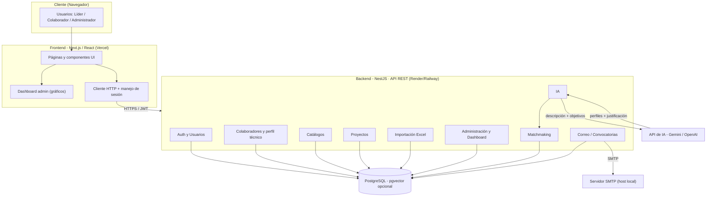
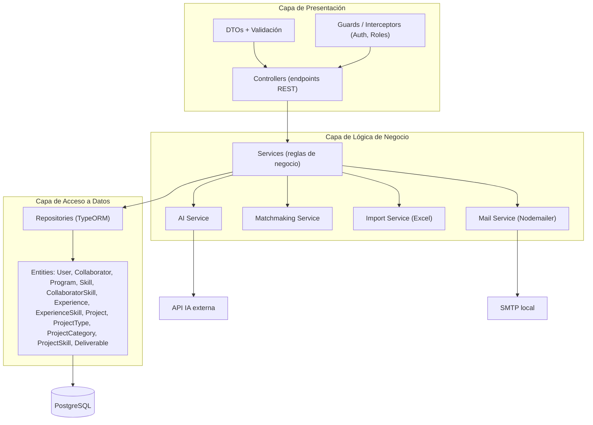
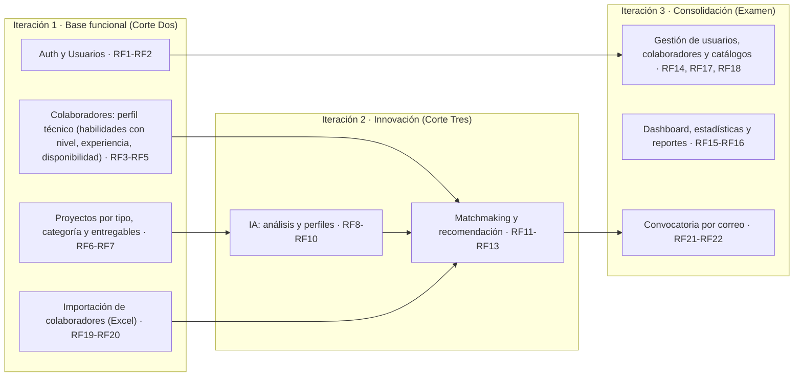
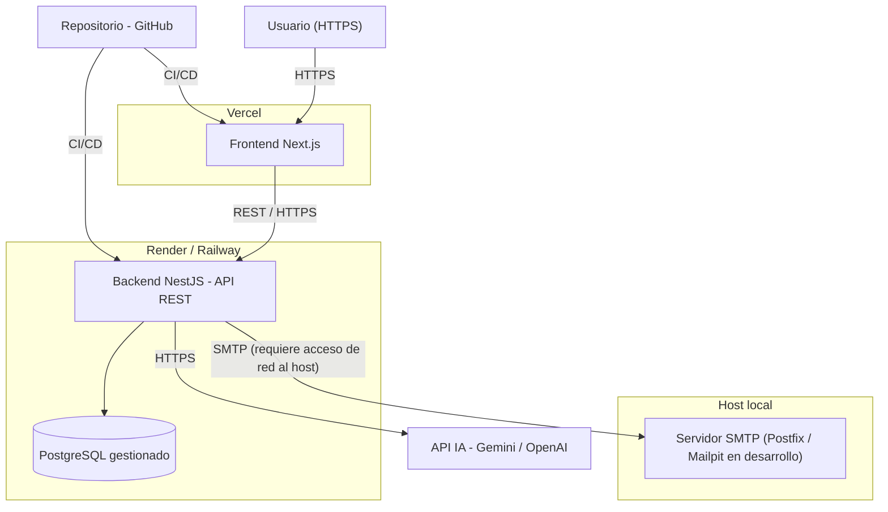
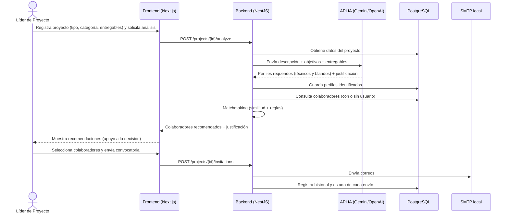
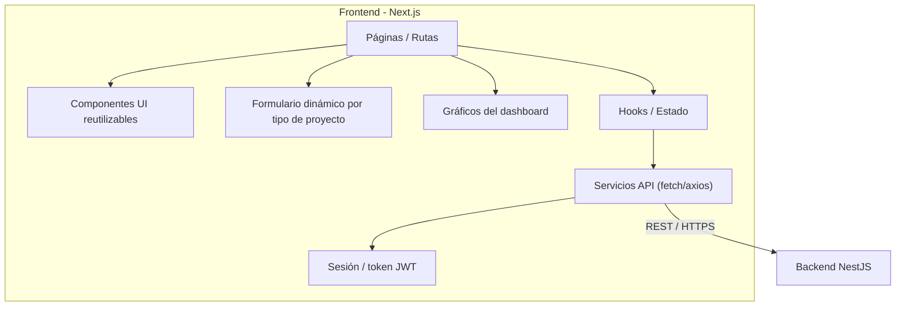

# Arquitectura — Conecta U (UFPS-CON-001)

> **Actualizado al Alcance Global v2.0 (25/09/2026):** Colaborador ≠ Usuario, catálogos (programas, habilidades, tipos/categorías), importación Excel, dashboard del administrador y correo por SMTP en host local. RF con numeración v2.0 (RF1–RF22).

Diagramas de arquitectura en Mermaid. Stack: **Next.js/React** (frontend), **NestJS/Node.js** (backend, API REST), **PostgreSQL** (con `pgvector` opcional), **IA por API** (Gemini/OpenAI), **motor de matchmaking**, **ExcelJS/SheetJS** (importación) y **Nodemailer + servidor SMTP local** (convocatorias). Sirven para la Fase de Diseño del Documento Ingenieril (2.3 Arquitectura del sistema).

---

## 1. Arquitectura general (vista de contenedores)

---

## 2. Arquitectura en capas (patrón MVC / NestJS)

---

## 3. Módulos por dominio y por iteración

---

## 4. Arquitectura de despliegue

> RT14: si el backend está en la nube, el servidor SMTP del host local debe ser alcanzable desde él (o, para la demo, correr backend y SMTP en el mismo equipo).

---

## 5. Flujo del núcleo IA + matchmaking + convocatoria (secuencia)

---

## 6. Arquitectura del frontend (Next.js)

---

### Notas
- **Colaborador ≠ Usuario:** `collaborators.userId` es opcional y único; el matchmaking y las convocatorias trabajan sobre colaboradores.
- **RT11:** si el matchmaking necesita búsqueda semántica, se evalúa PostgreSQL + `pgvector` antes de agregar otra base de datos.
- **RT8:** claves API, credenciales y parámetros SMTP por variables de entorno.
- Las recomendaciones de la IA son **apoyo a la decisión**: el líder decide a quién convocar.
- Para la Entrega 2 (Iteración 1) aplican solo los módulos It1 de la sección 3.
